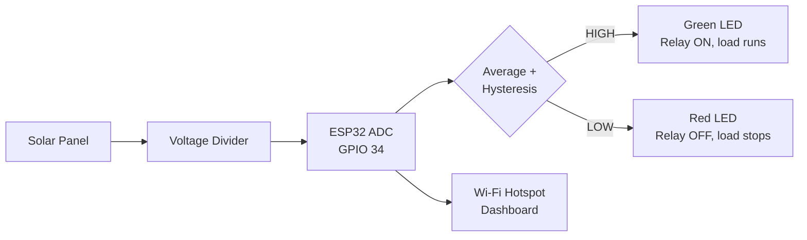

# SolarSync

### Smart Solar-Aware Load Controller

*Run heavy loads only when the sun is strong. Low-cost. Works completely offline.*

**Platform:** ESP32 (Arduino) | 

---

## The Problem

Solar power is wasted when heavy loads like water pumps and geysers run at the wrong time. Existing smart energy systems are **costly** and need an **internet connection**, which puts them out of reach for farms, hostels, schools and small households.

## Our Solution

**SolarSync** is a low-cost ESP32 controller that measures how much sunlight the solar panel is getting and switches a load **ON only when sunlight is strong**. It shows live status on LEDs and on a dashboard hosted by the ESP32 itself, so no router or internet is needed.

---

## Features

| Feature | Description |
|---------|-------------|
| **Sunlight sensing** | Reads panel voltage through a voltage divider (GPIO 34) with heavy averaging |
| **Two-step calibration** | Bright, then covered. Thresholds adapt to the real demo setup |
| **High / Low classification** | Hysteresis gap prevents relay chatter |
| **Automatic load switching** | Relay turns the load ON in strong sun, OFF when it drops |
| **Trend advisory** | "Sunlight dropping, finish heavy loads soon" |
| **Offline dashboard** | ESP32 creates its own Wi-Fi hotspot and serves the page |
| **Manual override** | Auto / Force ON / Force OFF from the button or the dashboard |
| **Impact tracker** | Live kWh on solar, rupees saved and CO2 avoided |

---

## Hardware

| Part | Purpose |
|------|---------|
| ESP32 DevKit | Brain, ADC, Wi-Fi hotspot, web server |
| 6V solar panel | Power source and sunlight sensor |
| 2 x 10k ohm resistors | Voltage divider (panel to 3.3V-safe signal) |
| 5V relay module (1-channel) | Switches the load |
| 5V USB fan | Demo load (stands in for a pump) |
| Green and red LEDs, 2 x 220 ohm | High / low sunlight indicators |
| Push button (optional) | Manual override |
| Breadboard and jumper wires | Connections |

> **Warning:** The prototype is low-voltage only (5V). Never connect mains to this circuit.

---

## Pin Map

| ESP32 Pin | Connected To |
|-----------|--------------|
| `GPIO 34` | Midpoint of 10k + 10k divider (panel) |
| `GPIO 25` | Green LED via 220 ohm (high sunlight) |
| `GPIO 33` | Red LED via 220 ohm (low sunlight) |
| `GPIO 18` | Relay `IN` |
| `GPIO 27` | Override button (other leg to GND) |
| `VIN` | Relay `VCC` and relay `COM` |
| `GND` | Common ground |

### Wiring

```
Panel (+) -- 10k --+-- 10k -- GND
                   |
               GPIO 34
Panel (-) ------------------- GND

Relay switch side:
ESP32 VIN --> COM
NO ---------> Fan (+)
Fan (-) -----> ESP32 GND
(NC left empty)
```

---

## How It Works



1. **Calibrate:** at startup, shine bright light on the panel (5 s), then cover it (5 s).
2. **Threshold:** midpoint of the two readings, with a hysteresis gap of 15% of the difference.
3. **Decide:** voltage above threshold + gap is HIGH. Below threshold - gap is LOW.
4. **Act:** relay and LEDs follow the state. The dashboard shows everything live.

---

## Getting Started

### 1. Setup
- Install **Arduino IDE** and add **ESP32 board support**.
- Select board: **ESP32 Dev Module**. Upload speed: **115200**.

### 2. Upload
- Open `solar_sync_final.ino` (keep `dashboard.h` in the same folder).
- Connect the ESP32 over USB and upload. Hold **BOOT** while it says "Connecting...." if needed.

### 3. Calibrate
- Open Serial Monitor at **115200** baud.
- Follow the prompts: bright light first, then cover the panel.
- Press **EN** to recalibrate any time. Do it at the real demo distance.

### 4. Open the dashboard
- Connect your phone to Wi-Fi **`SolarSync`** (password `solar1234`).
- Open **http://192.168.4.1** in the browser.

---

## Impact

| Assumption | Value |
|-----------|-------|
| Load shifted to solar | 1.5 kW x 3 h/day |
| Energy shifted | **about 135 kWh / month** |
| Savings per household | **about Rs 800 - 1,000 / month** |

Multiply that across farms, hostels and schools and the savings and CO2 reduction add up fast.

---

## Future Scope

- Multiple relays with load priorities (pump first, geyser next)
- Battery state awareness
- Weather-based scheduling
- Optional cloud logging when internet is available
- Current sensor (INA219) or light sensor for more accurate sunlight measurement
- Certified contactor and enclosure for real mains-rated deployment

---

## FAQ

**Why not just use a timer?** Weather and seasons change daily. SolarSync reacts to actual sunlight.

**Is it safe for mains?** This prototype is 5V only. A production version needs a certified contactor and enclosure.

**Can a solar panel really sense light?** Loaded panel voltage tracks light well. We use averaging and calibration to handle noise. A production version would add a dedicated sensor.